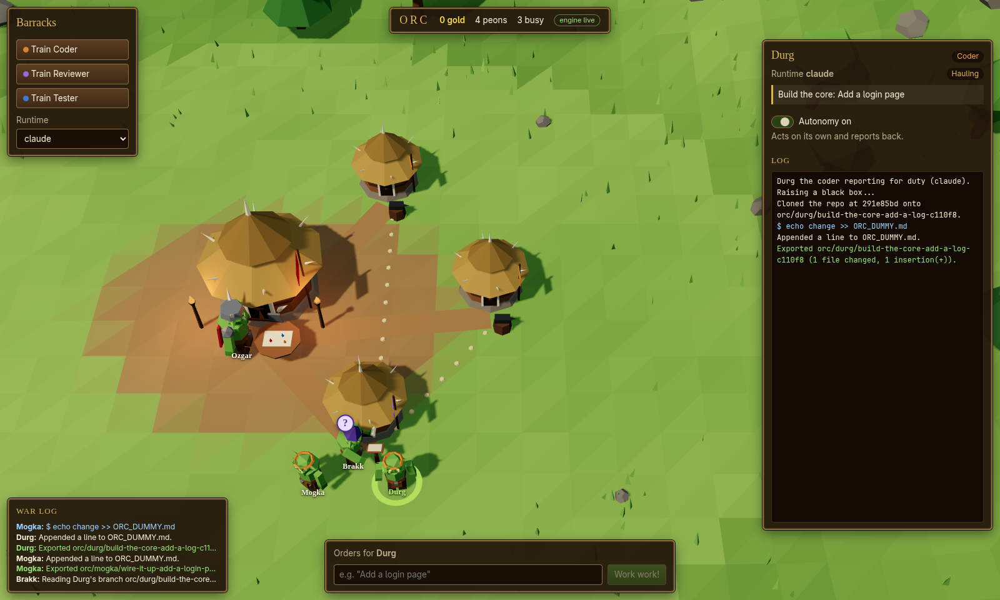

# Orc

**An RTS for AI coding agents.** Train orc peons, point your chieftain at a repo, give orders, and watch
them work. Every peon codes inside its own disposable Docker container, and finished, reviewed work
lands in your repo as a branch for you to merge.



> Status: early prototype. The full loop works end to end (plan, approve, code in black boxes, review,
> fix, deliver). Expect rough edges.

---

## Contents

- [Why orc](#why-orc)
- [How it plays](#how-it-plays)
- [Quick start](#quick-start)
- [Runtimes and credentials](#runtimes-and-credentials)
- [The black boxes](#the-black-boxes)
- [Controls](#controls)
- [Configuration](#configuration)
- [Development](#development)
- [Project layout](#project-layout)
- [Roadmap](#roadmap)
- [Further reading](#further-reading)

## Why orc

Running several coding agents at once is powerful and hard to keep track of. orc turns that into
something you can *see*: each agent is a unit on a map, its state is an animation (thinking, hammering,
hauling a crate of code to the reviewer, waving for your approval, smoking when something broke), and
one click shows its live log.

It is also built so you can let agents run with full permissions without worrying about your machine:
they never touch your files. They work on copies inside throwaway containers, and the only thing that
comes back is a git branch.

## How it plays

```
           you
            │ orders
            ▼
   ┌──────────────────┐   battle plan    ┌──────────────┐
   │ Ozgar, chieftain │ ───────────────► │ coder peons  │  each in its own black box,
   │ (reads the repo) │  (you approve)   │ (and testers)│  on its own branch
   └──────────────────┘                  └──────┬───────┘
            ▲                                   │ branch (a crate)
            │ gold: orc/<peon>/<task> branch    ▼
            │       fetched into your repo  ┌──────────┐
            └────────────────────────────── │ reviewer │──► findings back to the coder
                                            └──────────┘    (up to 2 fix rounds)
```

| Unit | Job |
|---|---|
| **Chieftain** (Ozgar) | Holds the *war target* (your repo). Reads it and splits your order into one task per worker. |
| **Coder** | Implements its task on a fresh branch, runs quick tests, commits. |
| **Tester** | Writes or improves tests for its task. |
| **Reviewer** | Reads the branch diff, approves it or sends specific findings back to the coder. |

**Autonomy** is a toggle on every orc. Off: it stops and shows you its plan or the commands it is about
to run, and waits for **Approve** / **Reject** (the "!" over its head). On: it acts and reports back.
The chieftain starts supervised; workers start autonomous.

**Failures** park the orc (smoke over its hut, red "x") with the error in its log until you press
**Retry** or **Abandon**.

**Gold** at the town hall means a reviewed branch landed in your repo:

```bash
git branch --list 'orc/*'
git log main..orc/durg/add-login-page-1a2b3c
git merge orc/durg/add-login-page-1a2b3c   # when you're happy
```

## Quick start

Requirements: Linux or macOS, Python 3.11+, Node 20+, Docker, git.

```bash
git clone git@github.com:jcmspg/Orc.git orc && cd orc

# Engine
python3 -m venv .venv
.venv/bin/pip install -e ".[dev]"
.venv/bin/orc build-image        # builds the orc-peon Docker image (a few minutes)

# Desktop app
cd web && npm install
```

Set up credentials for at least one runtime ([below](#runtimes-and-credentials)), then:

```bash
cd web && npm start              # builds the app, starts the engine, opens the window
```

1. Click **Ozgar**, type your repo's path under **War target**, press **Set**.
2. With Ozgar selected, type an order and press **Enter**: *"Add input validation to the signup form"*.
3. Approve his battle plan. Watch the peons work; click any of them for its live log.
4. When gold lands, merge the `orc/...` branch.

Want to look around first without Docker or model calls? `ORC_SIM=1 npm start` runs a self-contained
simulation, and `ORC_FAKE_AGENT=1 npm start` runs the real engine and black boxes with a dummy agent.

## Runtimes and credentials

Every peon has its own runtime, chosen in the Barracks when you train it. The default village runs on
`claude`.

| Runtime | CLI in the box | Credential | Where to get it |
|---|---|---|---|
| `claude` | Claude Code (`--dangerously-skip-permissions`) | `CLAUDE_CODE_OAUTH_TOKEN` (your Pro/Max subscription) or `ANTHROPIC_API_KEY` (API billing) | `claude setup-token` in your own terminal |
| `cursor` | Cursor agent CLI (`--force`) | `CURSOR_API_KEY` | [cursor.com/dashboard/api](https://cursor.com/dashboard/api) |
| `copilot`, `codex` | not yet | | greyed out in the Barracks |

Why tokens and not your normal login: the boxes can't see your home directory (that's the point), so
they can't use `~/.claude` or `~/.cursor`. A token made for headless use is the clean way in.

**Easiest: paste it in the app.** On first launch with no credentials, **Menu → Settings** opens by
itself. Paste the token and press Save. orc writes it to `~/.config/orc/env` (created with mode 600,
readable only by you), uses it immediately, and loads it on every start. Saved values are never shown
again; the app only shows *Saved*, *From environment* or *Not set*.

Or manage the file yourself. It holds plain `export NAME=value` lines, so your shell can source it too:

```bash
mkdir -p ~/.config/orc && install -m 600 /dev/null ~/.config/orc/env
${EDITOR:-nano} ~/.config/orc/env
#   export CLAUDE_CODE_OAUTH_TOKEN=...
#   export CURSOR_API_KEY=...
```

A variable already set in your environment takes priority over the file.

orc forwards credentials into a box by variable *name* (`docker exec -e NAME`), so their values never
appear on a command line. Each order uses real model time on your plan: one planning run, plus one run
per worker and per review round.

## The black boxes

Every job (planning, coding, reviewing) gets a fresh container from the `orc-peon` image:

- Debian + Node 22 + git + Claude Code + Cursor CLI, running as the unprivileged `node` user.
- `--cap-drop ALL`, `no-new-privileges`, 4 GB memory, 2 CPUs, 1024 processes.
- **No host directories mounted.** The repo goes in as a `git bundle` of your current `HEAD`
  (uncommitted changes are not included). Work comes out as a bundle and is fetched into your repo as
  `orc/<peon>/<task>-<id>`. Your checked-out branch and working tree are never touched.
- A coder's box lives until its branch is delivered or abandoned (so review fixes continue in the same
  box); planning and review boxes are destroyed as soon as they finish.

Read [SECURITY.md](SECURITY.md) for what this does and doesn't protect against. In short: your files
are safe from the agents, but the boxes have network access and can see the credential you gave them.

## Controls

| Action | Input |
|---|---|
| Select a peon | left-click (peon or its hut) |
| Select several | drag a box; shift-click to add or remove |
| Give orders | `Enter` (focuses the command bar), type, `Enter` |
| Pan | right-drag, or `WASD` / arrow keys |
| Zoom | mouse wheel |
| Rotate | middle-drag, or `Q` / `E` |
| Recentre on the village | `H` |
| Deselect | `Esc` |
| Menu (settings, controls, quit) | `Esc` with nothing selected, or the **Menu** button |
| Quit | `Ctrl+Q` or close the window (asks first if peons are working) |
| Fullscreen / devtools | `F11` / `F12` |

Quitting shuts the engine down cleanly: running jobs stop and their black boxes are destroyed. If the
app is killed instead, the engine notices within a couple of seconds and shuts itself down the same way.

## Configuration

| Variable | Default | Effect |
|---|---|---|
| `ORC_PORT` | `47820` | Port of the engine server (`orc serve --port` for the CLI). |
| `ORC_SIM` | unset | `1`: run the in-app simulation, no engine, no Docker. |
| `ORC_FAKE_AGENT` | unset | `1`: real engine and boxes, dummy agent (no model calls). |
| `ORC_NO_SERVER` | unset | `1`: don't start `orc serve` from the app (run it yourself). |
| `CLAUDE_CODE_OAUTH_TOKEN` / `ANTHROPIC_API_KEY` | | Claude Code credentials for the boxes. |
| `CURSOR_API_KEY` | | Cursor credentials for the boxes. |

The app also accepts `?sim` and `?server=ws://host:port/ws` in its URL.

## Development

```bash
.venv/bin/pytest                       # Python tests (no Docker or model calls needed)
cd web && npm run typecheck            # TypeScript
cd web && npm run build                # production bundle into web/dist

# Hot reload: two terminals
cd web && npm run dev                  # Vite dev server
cd web && npm run dev:app              # Electron window pointed at it (also starts the engine)

.venv/bin/orc serve                    # the engine on its own
```

The engine tests run whole plan → code → review → deliver flows with real git, using temp directories
as stand-in boxes and a dummy agent. See [AGENTS.md](AGENTS.md) for conventions and
[docs/ARCHITECTURE.md](docs/ARCHITECTURE.md) for the event protocol.

### Troubleshooting

- **`Electron failed to install correctly`** (npm 11+ with Node 26 can extract Electron incompletely):

  ```bash
  cd web/node_modules/electron && rm -rf dist && mkdir dist \
    && unzip -q "$(find ~/.cache/electron -name 'electron-v*-linux-x64.zip' | head -1)" -d dist \
    && printf electron > path.txt
  ```

- **"Engine offline" in the app:** the app starts `.venv/bin/orc serve` itself; check the terminal you
  ran `npm start` from. If the port is taken, set `ORC_PORT`.
- **Peon fails with "no credentials inside the black box":** export the variable for its runtime and
  restart the app (the engine reads the environment at startup).
- **`orc-peon` image missing:** `.venv/bin/orc build-image`.

## Project layout

```
src/orc/
  engine.py        job queues per orc; plan / code / review / deliver flows; approvals, retries
  sandbox.py       Docker black boxes (create, exec, copy in/out, destroy) and image build
  docker/          Dockerfile for the orc-peon image
  runtimes.py      how each agent CLI runs inside a box; stream parsing into log lines
  prompts.py       role prompts and parsers for plans and review verdicts
  gitops.py        the only operations on your repo: bundle HEAD, fetch finished branches
  board.py         server-side board state; events match web/src/types.ts
  server.py        FastAPI WebSocket server (`orc serve`)
  providers.py     direct model access (Anthropic API, host CLIs) as a library
web/
  electron/        desktop shell; starts the engine
  src/world/       Three.js village: terrain, models, peon animations, effects, camera
  src/App.tsx      HUD: barracks, unit panel, war log, command bar
  src/remote.ts    WebSocket engine client      src/engine.ts  in-app simulation
tests/             pytest suite (fakes.py has the temp-dir sandbox)
docs/              architecture notes and images
```

## Roadmap

- Copilot and Codex runtimes in the boxes.
- Persist the board (units, history, gold) across launches.
- Merge from the app, with diff view.
- Network allow-lists for boxes; per-orc resource budgets.
- Spend tracking per peon.
- More unit types (researcher, documenter) and custom personas.

## Further reading

- [AGENTS.md](AGENTS.md): working on this repo (for humans and AI agents)
- [docs/ARCHITECTURE.md](docs/ARCHITECTURE.md): engine, event protocol, flows
- [SECURITY.md](SECURITY.md): black-box threat model
- [CONTRIBUTING.md](CONTRIBUTING.md)

## License

[MIT](LICENSE)
